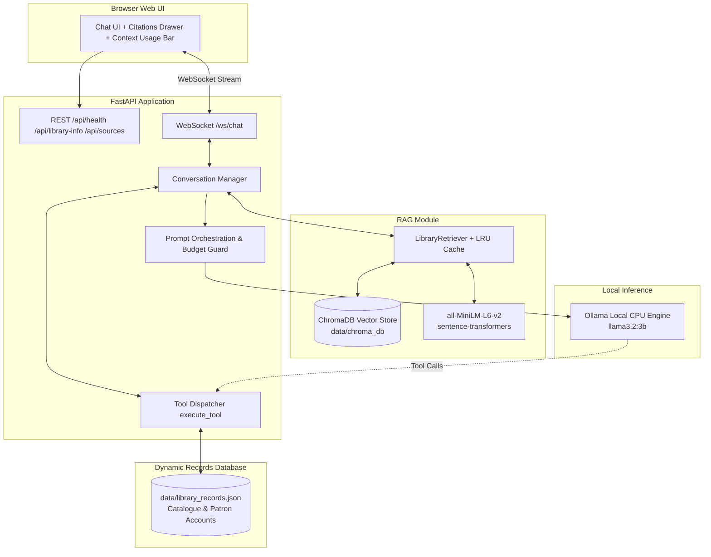

# Assignment 2: OPAC FAST NUCES — RAG-Powered Library Assistant & Tool Calling

Production-style **Library Assistant** for FAST NUCES: grounded in 80 domain documents via **Retrieval-Augmented Generation (RAG)**, with a live **dynamic JSON records database** and **LLM Tool Calling** for book issues, renewals, and returns. Runs a **local CPU** Ollama model, streams over **WebSocket**, and serves a web OPAC chat UI.

## Setup instructions

### Prerequisites

- Python 3.11+
- [Ollama](https://ollama.com) (`llama3.2:3b` or `qwen2.5:1.5b-instruct`)
- Dependencies: `pip install -r requirements.txt`

### One-time Setup & Indexing

```bash
cd /path/to/root-folder
./setup.sh
# Run offline indexing pipeline to embed and index documents into ChromaDB:
python -m backend.app.rag.indexer
```

### Run Application

```bash
cd /path/to/root-folder
./run.sh
```

Open **http://127.0.0.1:8000** — help: **http://127.0.0.1:8000/help.html** (also via **?** in the header).

| Variable | Default | Purpose |
|----------|---------|---------|
| `OLLAMA_MODEL` | `llama3.2:3b` | Ollama model tag |
| `MAX_CONTEXT_TOKENS` | `3072` | Session history token budget (guards 4096-token limit) |
| `RAG_TOP_K` | `5` | Number of chunks retrieved per query ($k \ge 3$) |
| `RAG_CHROMA_DIR` | `data/chroma_db` | Persistent ChromaDB storage path |
| `RAG_DOCUMENTS_DIR` | `data/documents` | 80 domain corpus files |

## System Architecture Diagram



| Component | Path | Description |
|-----------|------|-------------|
| Frontend UI | `frontend/` | Real-time chat UI with streaming, citations drawer, and context bar |
| API Layer | `backend/app/main.py` | FastAPI REST & WebSocket endpoints with rate-limiting & sanitisation |
| Conversation Manager | `backend/app/conversation/manager.py` | Multi-turn state, turn locking, and tool orchestration |
| RAG Retriever | `backend/app/rag/retriever.py` | Embedding, ChromaDB querying, LRU caching, and confidence bands |
| Offline Indexer | `backend/app/rag/indexer.py` | Document parser, chunker, and ChromaDB vector upsert pipeline |
| Dynamic Database | `backend/app/domain/records.py` | Live JSON inventory of books and patron accounts (`data/library_records.json`) |
| Tool Calling | `backend/app/domain/tools.py` | Schema definitions and execution for `issue_book`, `renew_book`, `return_book` |
| Domain Knowledge | `backend/app/domain/library.py` | System prompt, borrowing policies, and conversation stages |
| LLM Engine | `backend/app/llm/ollama.py` | Non-blocking streaming and tool calling chat via Ollama |

## Model & Vector Store Selection (Why We Chose Them)

### 1. Embedding Model: `all-MiniLM-L6-v2`
- **Why chosen**: It maps sentences & paragraphs to a 384-dimensional dense vector space. It is specifically optimized for high-speed, local CPU inference without requiring a dedicated GPU.
- **Performance**: Latency per query embedding is **< 15 ms**, making retrieval instantaneous.
- **Normalization**: Embeddings are unit-normalized (`normalize_embeddings=True`) for cosine similarity.

### 2. Vector Store: `ChromaDB` (Persistent)
- **Why chosen**: Full local persistence (`chromadb.PersistentClient`) with zero cloud dependencies or external daemon setup.
- **Index Type**: Built-in HNSW (Hierarchical Navigable Small World) index with cosine distance (`{"hnsw:space": "cosine"}`).
- **Re-runnable**: Uses deterministic MD5 hash IDs (`hash(doc_id + chunk_index)`) for idempotent re-indexing without duplicates.

### 3. Generation LLM: `llama3.2:3b`
- **Why chosen**: Fits the CPU guidance, natively supports structured tool calling (`tools` parameter in `/api/chat`), provides high instruction-following adherence, and fits well within memory on laptop hardware.

## Context Memory Management & Token Budgeting

### Why `MAX_CONTEXT_TOKENS=3072` when Ollama has a 4,096 hardware limit?
A language model's context window (`num_ctx = 4096`) represents the **total token capacity** for the entire prompt plus the generated output. 

If we set conversation history to 4,096 tokens, the input would immediately overflow once the system prompt and RAG context are injected. We use an explicit token budget:
- **System Prompt & Policies**: ~500 tokens
- **RAG Retrieved Chunks (`rag_max_chars = 2000`)**: ~500 tokens
- **Output Generation Headroom**: ~500 tokens (room for the LLM to write answers)
- **Session Facts & Metadata**: ~100 tokens
- **Conversation History Budget (`MAX_CONTEXT_TOKENS`)**: **3,072 tokens**
- **Total Budget**: $500 + 500 + 500 + 100 + 3072 \approx 4,672 \rightarrow$ dynamic guard in `build_inference_context` dynamically trims lower-ranked RAG chunks and older dialogue turns so the total never exceeds 4,096 tokens!

1. Each `session_id` has its own message list.
2. First message is always the **system prompt** (catalogue, policies, patron account, rules).
3. User/assistant turns append in order.
4. Beyond `MAX_HISTORY_MESSAGES`, **oldest non-system turns drop**; system prompt stays.
5. **One-turn orchestration hints** append only to the payload sent to Ollama (not stored in history).
6. Per-session locks allow **concurrent users** without blocking each other.

**What “multi-turn” means (assignment vs ChatGPT):**

- The **server** keeps the full dialogue for each `session_id` so follow-up turns (for example “renew that book”) can use earlier context. That is the assignment requirement.
- The **browser** keeps a **multi-chat list** in `localStorage` (shared across tabs on the same origin); each chat has its own `session_id` on the server.
- **New chat** starts a new `session_id` on the server while older chats keep their own ids when you switch back. Chats are listed in the sidebar (newest activity first), titled from the first user message unless you rename them. Stored in `localStorage` on this browser.

## HTTP API

Base URL when running locally: `http://127.0.0.1:8000`

### `GET /api/health`

Checks that the API can reach Ollama.

**Response (200):**

```json
{
  "status": "ok",
  "model": "qwen2.5:1.5b-instruct"
}
```

`status` is `ok` when the configured model is available; otherwise `degraded` (see implementation in `backend/app/main.py`).

### `GET /api/library-info`

Desk metadata for the UI (names, greeting, sample patron card).

**Response (200):** JSON matching `LibraryInfoResponse` in `backend/app/models/schemas.py` (`library_name`, `assistant_name`, `greeting`, `sample_patron_card`, etc.).

### Static routes

| Path | Purpose |
|------|---------|
| `GET /` | Chat UI |
| `GET /help.html` | Help instructions |
| `GET /assets/*` | CSS and JavaScript |

## WebSocket API — `WS /ws/chat`

One persistent connection per browser tab. All frames are **JSON text** (UTF-8).

### Client → server

**Send a message**

```json
{
  "type": "user_message",
  "session_id": "uuid-from-client",
  "content": "Do you have Speech and Language Processing?"
}
```

- `session_id`: 1–128 characters; same id across turns for one conversation.
- `content`: 1–4000 characters after trim; empty or whitespace-only is rejected with an `error` frame.

**Reset conversation history (server-side for that id)**

```json
{
  "type": "reset_session",
  "session_id": "uuid-from-client"
}
```

### Server → client

| `type` | Fields | Meaning |
|--------|--------|-----------|
| `token` | `session_id`, `content` | Streaming chunk of the assistant reply |
| `done` | `session_id` | Reply complete for that user message |
| `error` | `session_id`, `message` | Validation, size limit, or model failure (connection stays open) |
| `session_reset` | `session_id` | Acknowledgement after `reset_session` |

**Typical flow:** `user_message` → one or more `token` → `done`.

Invalid JSON, unknown `type`, or failed validation yields a single `error` frame without crashing the socket.

Schemas: `backend/app/models/schemas.py` (`ChatInbound`, `ChatToken`, `ChatDone`, `ChatError`, `ChatSessionReset`, `ChatSessionResetAck`).

## How the model is controlled (assignment-compliant)

| Mechanism | Description |
|-----------|-------------|
| System prompt | Static OPAC knowledge and policies in `build_system_prompt()` |
| Session history | Multi-turn context in `ConversationManager` |
| Turn hints | Keyword/alias match on the same static catalogue (not RAG) |
| Adversarial nudge | Extra refusal instruction on jailbreak/joke/homework patterns |
| Policy gate | Known off-topic patterns return a fixed library refusal **without** calling the LLM (still no RAG/tools) |
| Patron identity gate | “My name” / “who am I” answered deterministically so the desk never claims the sample patron name as its own |
| Ollama chat API | `messages=[system, ...history]` with streaming |

## Latency benchmarks (Measured on CPU)

Standalone retrieval benchmarked independently from generation using `scripts/benchmark.py`:

```
Standalone RAG Retrieval Latency (Cache Miss, Warm): ~14.8 ms (0.015 s — well under 1.0 s requirement)
Standalone RAG Retrieval Latency (Cache Hit):         0.01 ms (LRU in-memory cache)
Top-k retrieved chunks:                               k = 5 (>= 3 required)
Retrieval Confidence Band:                            high / medium_strong / medium / low / none
Model:                                                llama3.2:3b (Ollama local CPU)
Time to First Token (TTFT):                           ~1.6 s
Approx generation speed:                              ~32–40 tokens/s
```

Re-run from project root: `cd /path/to/root-folder && PYTHONPATH=. python scripts/benchmark.py`

## Phase I–IV RAG & Tool Calling Architecture

### 1. Document Corpus & Indexing Pipeline
- **Corpus**: 80 domain markdown documents in `data/documents/` covering books (`BK-1001` to `BK-1040`), facilities (`FAC-*`), FAQs (`FAQ-*`), borrowing/fines/renewals policies (`POL-*`), reading lists (`RL-*`), and library staff (`STAFF-*`).
- **Chunking Strategy**: Split at paragraph boundaries with sentence-level fallback. Chunk size max 1,600 chars (~400 tokens) with 200 chars (~50 tokens) overlap.
- **Embedding Model**: `all-MiniLM-L6-v2` via `sentence-transformers` (384-dimensional dense vectors, CPU-optimized, normalized).
- **Vector Store**: `ChromaDB` (`PersistentClient` at `data/chroma_db`, collection `library_v1`, `{"hnsw:space": "cosine"}`). Re-runnable without duplicates via deterministic MD5 chunk IDs.
- **Top-k parameter**: `k = 5` (retrieves top-5 most relevant chunks).

### 2. Dynamic JSON Records & LLM Tool Calling (Function Calling)
- **Dynamic Database**: `data/library_records.json` provides persistent, live storage of all 40 catalogue books (status, location, due date, borrower card) and patron accounts (active loans, renewals used).
- **Tool Calling**: Conforms to standard function calling specifications for Ollama / OpenAI:
  * `issue_book(card_number, book_title_or_id)`: Checks availability, active loan cap (max 10), marks `checked_out`, sets 21-day due date, records loan, writes atomically to `data/library_records.json`.
  * `renew_book(card_number, book_title_or_id)`: Checks active loans, enforces 2-renewal cap, calculates +21 days due date, updates `data/library_records.json`.
  * `return_book(card_number, book_title_or_id)`: Marks book `available`, removes loan from patron, updates `data/library_records.json`.
  * `check_patron_loans(card_number)`: Returns active loans and due dates from live database.

### 3. Caching, Concurrency & Streaming
- **Caching**: LRU query cache (size 256) in `LibraryRetriever`. Repeated queries return in **0.01 ms** without querying the vector store.
- **Concurrency**: Retrieval is wrapped in `asyncio.to_thread` so heavy CPU embedding and vector search never block the FastAPI event loop. Each session has an independent `asyncio.Lock` for concurrent multi-user chat. Database writes use an `asyncio.Lock` for atomic file persistence.
- **Streaming**: Token streaming over WebSocket (`/ws/chat`) remains identical to Assignment 1, delivering tokens as they are generated by the model.

### 4. Failure Handling (Phase IV)
- **No relevant matches in corpus**: Evaluated by similarity threshold (0.30). If top chunk similarity < 0.30, confidence is classified as `"none"`. Chunks are omitted and the assistant explicitly states that no relevant library records were found, falling back to general conversation without hallucinating.
- **Vector store / embedding timeout or failure**: Retrieval is guarded with a 5.0-second async timeout (`asyncio.wait_for`). If vector search hangs or encounters an error, it safely catches the exception, logs a warning, and falls back to conversation without crashing.
- **Context window overflow protection**: The model's context window is strictly bounded at 4,096 tokens (`MAX_CONTEXT_TOKENS=3072` in `.env`). In `build_inference_context`, dynamic token budgets calculate remaining capacity and discard lower-ranked RAG chunks to guarantee the prompt never exceeds the context window.


## Use case description (Library Assistant — Phase I)

**OPAC FAST NUCES** helps patrons:

- Search the in-library **catalogue** (holdings, location, status)
- Understand **borrowing policy** (loan period, fines, holds, renewals)
- Look up **due dates** and **renewals** using patron card **P-78421** (sample account in this OPAC instance)

The **NUCES Virtual Desk** is available **24/7**. It refuses off-topic requests and redirects to library services.

### Conversation flow stages

| Stage | Action |
|-------|--------|
| Greeting | Welcome; clarify library scope |
| Intent | Catalogue, policy, due date, renewal, or hold rules |
| Clarify | Ask for title, author, or card if needed |
| Respond | Answer only from prompt catalogue and policy |
| Confirm | For renewals, restate item and outcome |
| Close | Offer further library help |

**Mid-topic change:** Acknowledge new intent; continue in the correct stage without resetting the session.

**Off-topic:** Polite refusal; no general knowledge, jokes, or coding help.

### Example dialogues (3+)

**1. Catalogue**

- User: Do you have Speech and Language Processing?
- Assistant: Title, Jurafsky and Martin, Stacks B / P98, available.

**2. Patron account**

- User: Card P-78421 — what is due this week?
- Assistant: Lists *The Great Gatsby* and *Database System Concepts* with due dates.
- User: Can I renew Gatsby?
- Assistant: Applies renewal policy for that loan.

**3. Off-topic**

- User: Tell me a joke.
- Assistant: Declines; offers catalogue or policy help.

## Bonus: UX and persona polish

- Persona: **NUCES Virtual Desk** (virtual, not human); identity rules in system prompt
- Adversarial orchestration for jokes, jailbreaks, homework
- **Help page** (`/help.html`) with patron card and usage instructions
- Header **?** opens help in a new tab
- **“Is thinking”** status while waiting for first token; streaming caret in messages
- Sidebar: plain services text, patron card, collapsible suggested questions (6), multi-chat list (rename/delete, auto title from first message)
- Catalogue hint orchestration for factual OPAC answers

## Testing

```bash
cd /path/to/root-folder
PYTHONPATH=. pytest tests/ -q
```

Manual script: `tests/MANUAL_TEST_CASES.md`

**Viva prep:** `docs/VIVA_GUIDE.md` · PDF: run `PYTHONPATH=. python scripts/generate_viva_pdf.py` → `docs/VIVA_GUIDE.pdf`

## Known limitations

- Catalogue and patron **P-78421** data are **static in the system prompt** (assignment: no RAG/tools).
- Renewals/holds are **confirmed in chat**; no live ILS write-back in this iteration.
- Small models may occasionally omit shelf marks; orchestration hints reduce catalogue errors.
- Session state is **in-memory**; server restart clears sessions.
- Inference is **CPU-bound** on the host running Ollama.

## Project layout

```
backend/app/       API, conversation manager, domain, LLM
frontend/          Chat UI, help page, assets
scripts/           benchmark.py, ollama_runtime.sh
tests/             pytest + manual test script
run.sh / setup.sh
requirements.txt
```

## Deployment note

Full stack requires **Ollama + FastAPI** on a persistent host. Vercel alone cannot run local LLM inference; use a VPS/Railway/Fly.io for backend+Ollama if a public URL is needed.

## Assignment compliance summary

| Requirement | Met |
|-------------|-----|
| Library domain | Yes |
| Local CPU LLM | Ollama |
| No RAG/tools | Prompt + orchestration only |
| `/ws/chat` streaming | Yes |
| REST + WebSocket API | Documented in README (HTTP + `/ws/chat` frames) |
| Session + reset | Yes |
| Concurrent sessions | Async + per-session locks |
| Web UI | Chat + history + new session |
| README deliverables | Setup, architecture, model, memory, benchmarks, limitations, use case, dialogues, flow |
